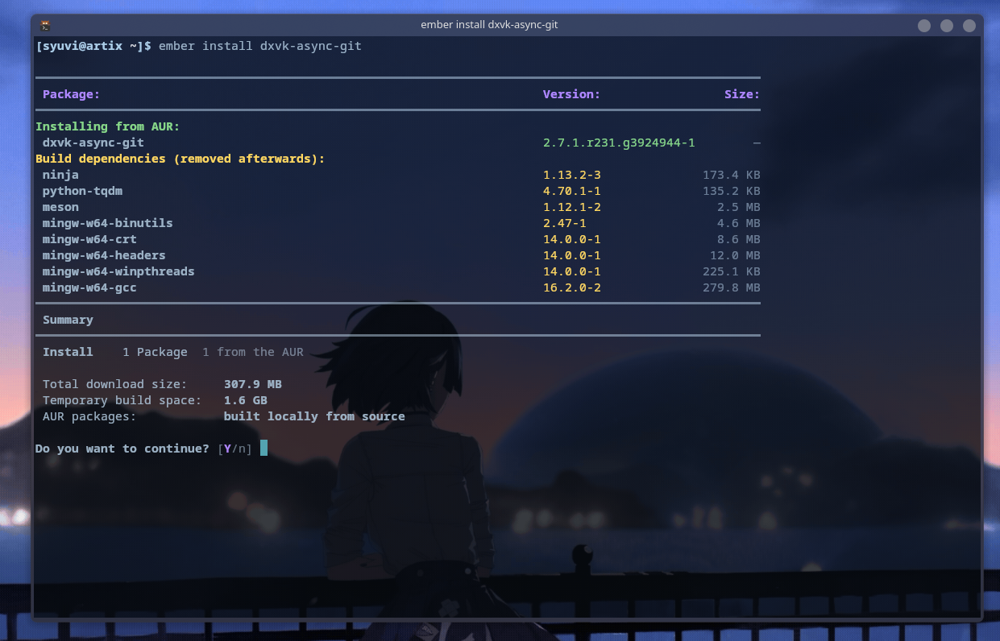

# Ember

**Ember** is a minimal AUR helper written in Ruby. It allows you to easily install, update, search, and remove AUR packages with a simple command-line interface.

How to install Ember and other information can be found in the [Wiki](https://github.com/syuvi211/ember/wiki/Ember-Wiki)
